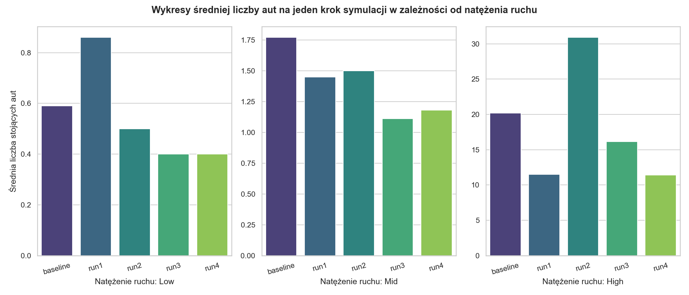
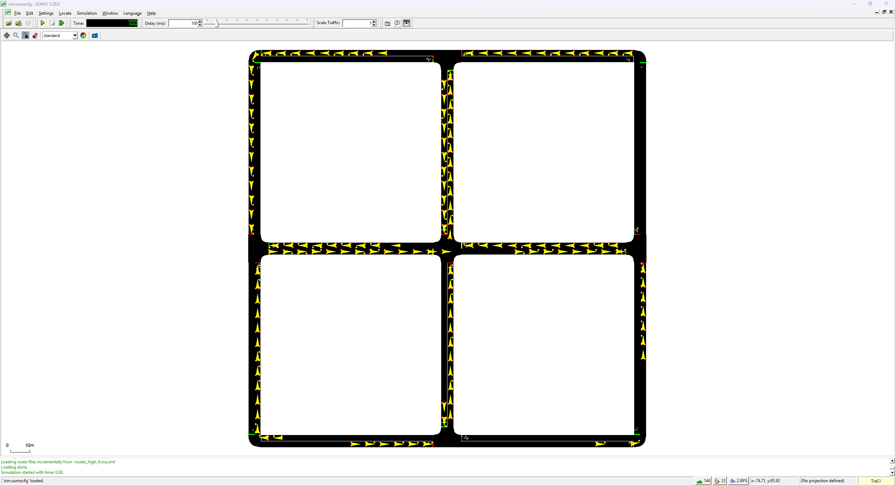
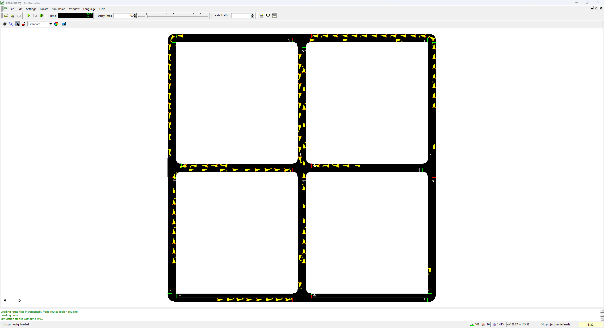

# Sterowanie sygnalizacją świetlną za pomocą  uczenia ze wzmocnieniem
Projekt stara się sprostać zadaniu optymalizacji skrzyżowania w ruchu drogowym. Agent uczenia ze wzmocnieniem, napisany w Pytorchu, steruje sygnalizacją świetlną symulacji w środowisku SUMO tak, aby jak najbardziej ograniczyć czas i ilość pojazdów stojących przed skrzyżowaniem, dodatkowo rozpatrując różne natężenia ruchu 

## Wyniki 
Agent osiągał średnio lepsze wyniki niż stałe światła trwające 10 sekund. Testy zostałe wykoanne na trzech nowych, losowo wygenerowanych trasach, przez co można zauważyć, że trasa nr 2 była zdecydowanie trudniejsza od pozostałych. Jako miarę przyjąłem średnią liczbę aut stojących na wszystkich dojazdach skrzyżowania na końcu każdego kroku decyzyjnego agentu (który trwał 5 sekund bez zmiany kierunku lub 8 sekund podczas zmiany). Ilustruje to tabela z dokładnymi wynikami oraz wykres poniżej:  
| | niski ruch | średni ruch | wysoki ruch |
|-|------------|-------------|-------------|
|baseline 10s|0.59|1.77|20.18|
|run1|0.86|1.45|11.49|
|run2|0.50|1.50|30.90|
|run3|0.40|1.11|16.15|
|run4|0.40|1.18|11.43|
|średnia z agenta|0.54|1.31|17.49|



Warto wziąć również pod uwagę, że światła trwające 10s miały najlepszy wynik spośród stałych czasów (np. przy 20s było to 1.09/3.10/26.29)  

Widzimy więc, że w małym ruchu run1 nie zdołał przebić baseline'u, a w wysokim nie udało się to drugiemu treningowi. Jednak w średnim ruchu, podobnie jak we wszystkich średnich wyniki te zostały przebite.

## Wizualizacja
Poniżej przedstawiam dwa screenshoty z dokładnie 70. sekundy przebiegu symulacji, pierwsza przy stałych światłach co 10 sekund, druga z modelu z run4. Naszym sterowanym skrzyżowaniem jest to znajdujące się w środku, oznaczone jako B1. Trasa to routes_high_4.rou.xml  





Na obrazku jeszcze lepiej widać, że nasz agent potrafi szybciej rozładować ruch, co również potwierdzają dana: na tej trasie średnia liczba stojących aut na skrzyżowaniu dla stałych świateł to 28.63, natomiast model zredukował to do 16.89.

Wizualizację można też uruchomić lokalnie, co jest opisane poniżej:

## Instalacja
Trening i testy zostały wykonane na Pythonie 3.13.1 i SUMO 1.28.0.  
### Jak zainstalować?
1. Zainstaluj SUMO i ustaw zmienną środowiskową `SUMO_HOME` na folder instalaccji. Po zmianie zresetuj terminal.
2. Zainstaluj potrzebne biblioteki Pythona:

```
pip install -r requirements.txt
```
## Uruchamianie
Komendy wypisane poniżej należy uruchamiać z głównego folderu repozytorium.
```
# ocena wytrenowanego agenta w zależności od ruchu na trasach 4-6
python src/evaluate_agent.py run4

# baseline
python src/evaluate.py

# podgląd w SUMO: stałe światła, potem agent, na trasie high_4
python src/visualize.py run4

# wykres porównawczy (zapisuje img/charts.png)
python src/charts.py

# trening (500 epizodów), należy wpisać nazwę przebiegu
python src/train.py run5
```

Trening zapisuje model w `models/model_{nazwa}.pt` i przebieg treningu w `results/result_{nazwa}.csv`. Wytrenowane przeze mnie dotychczas również się tam znajdują.

## Opis działania agenta
Działamy na sieci skrzyżowań 3x3 wygenerowanej przez `netgenerate`, przy czym nasz agent koncentruje się wyłącznie na optymalizacji środkowego skrzyżowania B1 (reszta działa domyślnie, ze stałymi światłami). Środowisko zostało opisane w `src/env.py` w klasie `TrafficEnv`. Określa ona:
- Stan: sześcioelementową listę zawierająca aktualną liczbę aut stojących na każdym z czterech pasów dojazdowych do skrzyżowania (na pierwszych czterech miejscach) oraz aktualną fazę (na ostatnich dwóch miejscach tej listy)
- Akcję: decyzję, która para przeciwległych świateł ma dostać zielone światło (przy zmianie doliczane są 3 sekundy żółtego światła) 
- Krok: trwa on 5 sekund symulacji
- Nagrodę: naszą miarę potrzebną do doskonalenia modelu, czyli minus sumę stojących aut na dojazdach
- Koniec epizodu: opuszczenie skrzyżowania przez wszystkie auta

### Algorytm (src/dqn.py, src/train.py)
